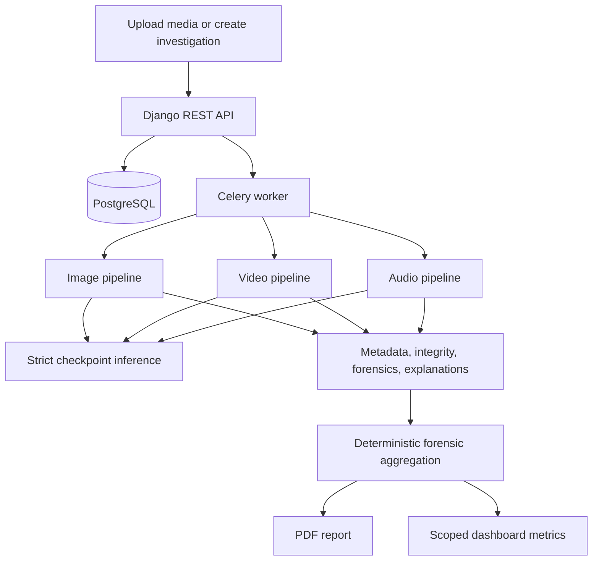
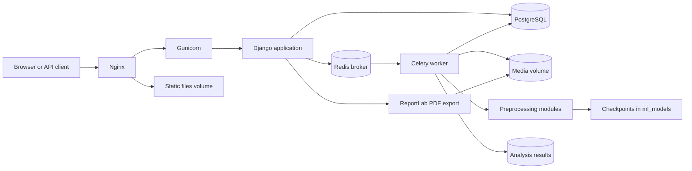

# DEEPFAKE SENTINEL

**A trustworthy, auditable workspace for image, video, and audio deepfake investigation.**

DEEPFAKE SENTINEL is a Django-based forensic analysis platform designed to help investigators collect media, extract metadata, run modality-specific detection pipelines, record integrity checks, manage investigations, and produce human-readable reports. The project is deliberately built as a **decision-support system**, not as an automatic truth machine.

> **Model honesty statement:** No trained model weights are bundled with this repository. Until you train a model with the scripts in `ml_training/` and produce a checkpoint under `ml_models/<modality>/weights/`, every prediction returned by the inference tooling is `INCONCLUSIVE`. No accuracy, precision, recall, F1, or AUC numbers are claimed by this project. Any metric shown in documentation is a placeholder only if explicitly labelled as such; generated metrics come exclusively from `metrics.json` and `evaluation.json` produced by your own runs.

> **Location:** This directory is the deployable application root. Run every command in this README from inside `Deep-Fake-Sentinel/`.

**Owner / license holder:** n j bala manikantan

## Repository map and execution flow

```text
Deep-Fake-Sentinel (application root)
├── README.md
├── LICENSE
├── requirements.txt
├── manage.py
├── config/
│   ├── settings.py
│   ├── urls.py
│   ├── api_router.py
│   └── celery.py
├── accounts/
├── investigations/
├── media_manager/
├── image_detection/
├── video_detection/
├── audio_detection/
├── forensic_analysis/
├── metadata_extractor/
├── integrity_verification/
├── ai_explanations/
├── reports/
├── dashboard/
├── ml_training/
│   ├── training/
│   ├── evaluation/
│   ├── preprocessing/
│   └── inference/
├── ml_models/
│   ├── image/weights/
│   ├── video/weights/
│   ├── audio/weights/
│   └── mediapipe/
├── static/
├── templates/
├── docs/
├── tests/
└── docker/
```



## Quick command reference

| Task | Command |
| --- | --- |
| Create virtual environment | `python -m venv .venv` |
| Install requirements | `python -m pip install -r requirements.txt` |
| Apply migrations | `python manage.py migrate` |
| Create admin user | `python manage.py createsuperuser` |
| Run development server | `python manage.py runserver` |
| Run tests | `python manage.py test tests -v 1` |
| Lint | `python -m ruff check .` |
| Format check | `python -m ruff format --check .` |
| Collect static files | `python manage.py collectstatic --noinput` |
| Start containers | `docker compose --env-file .env -f docker/docker-compose.yml up --build -d` |
| Start Celery worker | `celery -A config worker --loglevel=info` |

---

## Table of contents

1. [Project introduction](#1-project-introduction)
2. [Problem statement](#2-problem-statement)
3. [Objectives](#3-objectives)
4. [Features](#4-features)
5. [Architecture](#5-architecture)
6. [Technology stack](#6-technology-stack)
7. [Repository layout](#7-repository-layout)
8. [Installation](#8-installation)
9. [Configuration](#9-configuration)
10. [Running the application](#10-running-the-application)
11. [Screenshots](#11-screenshots)
12. [ML model details](#12-ml-model-details)
13. [Training and evaluation workflow](#13-training-and-evaluation-workflow)
14. [Dataset references and licensing](#14-dataset-references-and-licensing)
15. [API documentation overview](#15-api-documentation-overview)
16. [Security considerations](#16-security-considerations)
17. [Limitations](#17-limitations)
18. [Future enhancements](#18-future-enhancements)
19. [Demo instructions](#19-demo-instructions)
20. [Model honesty statement](#20-model-honesty-statement)
21. [Contributing](#21-contributing)
22. [License](#22-license)

---

## 1. Project introduction

Synthetic media is now cheap to generate and difficult to distinguish from authentic content by visual inspection alone. Journalists, trust and safety teams, educators, legal investigators, and internal risk functions need a repeatable way to answer questions such as:

- Was this image manipulated?
- Does this video contain spliced, replaced, or generated faces?
- Does this audio clip contain spoofed or synthesized speech?
- Is the file's metadata consistent with its claimed origin?
- Can the evidence trail be reproduced by a second reviewer?

DEEPFAKE SENTINEL provides a structured workflow for those questions. It combines:

- A Django web application and REST API surface for case management.
- Modality-specific analysis pipelines for images, videos, and audio.
- Deterministic preprocessing helpers used by both training and inference.
- Forensic metadata and integrity checks that complement model scores.
- Celery-backed asynchronous jobs for long-running analysis.
- PDF report generation through ReportLab.
- Clear separation between **evidence**, **model output**, and **human conclusion**.

The platform is intentionally conservative. A model score is one signal among many. It never overrides an investigator's judgment, and it never claims certainty when no validated checkpoint is available.

### Who this is for

| Audience | How DEEPFAKE SENTINEL helps |
| --- | --- |
| Trust and safety analysts | Queue submitted media, track findings, and export review packets. |
| Investigative journalists | Preserve provenance, inspect metadata, and document chain of custody. |
| ML engineers | Reproduce preprocessing, train modality models, and evaluate on held-out splits. |
| Educators and researchers | Demonstrate the limits and ethics of synthetic-media detection. |
| Compliance teams | Retain structured, reviewable records of analysis decisions. |

### What this repository contains

This checkout contains the implemented Django application: REST API routes under `/api/`, server-rendered dashboard, media, investigation, and report pages, JavaScript clients that consume the API, modality analysis services, metadata and integrity checks, deterministic forensic aggregation, PDF report generation, Celery processing, Docker Compose deployment files, and local ML training/evaluation tooling. No trained deepfake classifier weights are bundled, so model verdicts remain `INCONCLUSIVE` until you produce checkpoints with your own training runs. A MediaPipe BlazeFace short-range TFLite asset is bundled at `ml_models/mediapipe/blaze_face_short_range.tflite` for face-count heuristics only; it is not a trained deepfake classifier.

Main areas:

- `accounts/`, `investigations/`, `media_manager/` — authentication, case workflow, media intake, status tracking, and access logs.
- `image_detection/`, `video_detection/`, `audio_detection/` — modality analysis records, heuristic signal extraction, and checkpoint-backed inference when weights are available.
- `forensic_analysis/`, `metadata_extractor/`, `integrity_verification/`, `ai_explanations/` — cross-signal evidence records, EXIF/container facts, SHA-256 comparison, and deterministic explanations.
- `reports/`, `dashboard/` — on-demand ReportLab PDF generation and analytics endpoints consumed by the workspace UI.
- `config/` — Django settings, URL routing, the `/api/` router, and Celery wiring.
- `templates/`, `static/` — dashboard, media, investigation, and report interfaces plus their CSS and JavaScript.
- `docker/` — Dockerfile, Compose stack, and Nginx configuration.
- `ml_models/`, `ml_training/` — local checkpoint layout, bundled MediaPipe face-detection asset, preprocessing, manifest, training, evaluation, and inference tooling.
- `docs/`, `tests/`, `requirements.txt`, `.env.example` — documentation, tests, dependencies, and configuration template.

---

## 2. Problem statement

Deepfake detection is a moving target. Generative models improve faster than detectors can be deployed, and a detector that performs well on one dataset often degrades on another domain, codec, compression level, language, or capture device. A naive "fake / real" button creates several risks:

1. **False confidence:** A score is treated as proof rather than a lead.
2. **Poor reproducibility:** Preprocessing and inference differ between training and production.
3. **Evidence loss:** Metadata, encoding history, and operator notes are not retained.
4. **Unclear provenance:** Investigators cannot tell which model version produced a result.
5. **Unbounded cost:** Long video and audio analysis blocks web requests.
6. **Privacy leakage:** Uploaded media is retained indefinitely or stored without access control.
7. **Unevaluated deployment:** A model is shipped without a held-out evaluation or a documented threshold.

DEEPFAKE SENTINEL addresses these problems by making the workflow explicit:

- Every submitted file becomes a tracked media asset.
- Every analysis run records the checkpoint, preprocessing configuration, and input hash.
- Every result is stored as evidence with an `INCONCLUSIVE` fallback.
- Every report can cite the underlying signals without overstating them.
- Every training run writes its own metrics file instead of relying on hard-coded claims.

---

## 3. Objectives

### Functional objectives

- Accept image, video, and audio uploads through a documented API.
- Maintain investigations with notes, reviewers, and status transitions.
- Extract metadata from images, videos, and audio using Pillow, piexif, Mutagen, and OpenCV.
- Verify basic file integrity using hashes and container-level checks.
- Run deterministic preprocessing shared by training and inference.
- Train separate models for image, video, and audio modalities.
- Evaluate models using accuracy, precision, recall, F1, and confusion matrices.
- Generate PDF reports that separate observed evidence from interpretation.
- Support asynchronous execution through Celery and Redis.

### Non-functional objectives

- **Reproducibility:** Fixed seeds, explicit manifests, versioned checkpoints.
- **Auditability:** Store input hashes, model identifiers, and configuration snapshots.
- **Safety:** Never emit a verdict without a validated checkpoint.
- **Security:** Enforce upload limits, authentication, authorization, and safe file handling.
- **Operability:** Provide Docker Compose, health checks, and clear deployment steps.
- **Maintainability:** Keep ML code independent from Django app internals.
- **Honesty:** Publish no unearned metrics and no fabricated screenshots.

### Explicit non-objectives

- DEEPFAKE SENTINEL does not detect every form of synthetic media.
- It does not prove authorship, intent, or authenticity.
- It does not automatically download large research datasets.
- It does not bundle pretrained or third-party detection weights.
- It does not replace legal, editorial, or forensic review.

---

## 4. Features

### 4.1 Media intake and management

- Upload validation by extension, MIME type, and size.
- Deterministic SHA-256 hashing for deduplication and chain of custody.
- Separate storage areas for `uploads`, `tmp`, `analysis`, and `reports`.
- Status tracking: `received`, `queued`, `processing`, `analyzed`, `flagged`, `archived`.
- Reviewer assignment and case linkage.

### 4.2 Image analysis

- EXIF orientation correction and metadata extraction.
- Face-region cropping support through MediaPipe when available.
- Deterministic resize and normalization.
- Model inference from `ml_models/image/weights/image_detector.pt`.
- Output fields: model score, label, checkpoint ID, preprocessing config, and caveats.

### 4.3 Video analysis

- Uniform frame sampling with a fixed frame budget.
- Frame-level visual evidence plus temporal aggregation.
- Container metadata via OpenCV and Mutagen where applicable.
- Model inference from `ml_models/video/weights/video_detector.pt`.
- Per-frame summary output suitable for human review.

### 4.4 Audio analysis

- Mono resampling to a fixed sample rate.
- Log-mel spectrogram extraction with deterministic padding or truncation.
- Container metadata via Mutagen and signal statistics via librosa.
- Model inference from `ml_models/audio/weights/audio_detector.pt`.

### 4.5 Forensic and integrity checks

- File hash verification.
- Header/footer sanity checks for common containers.
- Metadata consistency observations.
- Explicit separation of **observation** and **interpretation**.

### 4.6 Investigations and reporting

- Investigation records with linked media and analysts.
- Timestamped notes and evidence attachments.
- AI-assisted explanations that are clearly labelled as generated text.
- PDF report export with evidence tables and limitations section.

### 4.7 ML tooling

- Local-folder manifest builders for every modality.
- Shared deterministic preprocessing modules.
- Training scripts that write checkpoints and real metrics.
- Evaluation scripts that compute held-out metrics from saved checkpoints.
- Standalone inference scripts that refuse to guess when weights are missing.

---

## 5. Architecture

The platform follows a layered architecture. Web requests terminate at Nginx, are served by Gunicorn running Django, and offload long tasks to Celery workers through Redis. PostgreSQL is the system of record. Media stays on a mounted volume. ML checkpoints are read directly from the repository-managed `ml_models/` tree.



### Layer responsibilities

| Layer | Responsibility |
| --- | --- |
| Nginx | TLS termination, static asset serving, request proxying, upload size guard. Media files are private and are accessible only through authenticated, object-scoped API download endpoints such as `GET /api/media/{id}/download/`. |
| Gunicorn | WSGI process management for Django. |
| Django | Authentication, API, validation, business rules, audit records. |
| PostgreSQL | Durable storage for users, media, jobs, findings, investigations, and reports. |
| Redis | Celery broker and result backend. |
| Celery | Asynchronous image, video, and audio analysis tasks. |
| Media volume | Original uploads, temporary files, derived frames, and generated reports. |
| Preprocessing | Deterministic transformations shared by training and inference. |
| Checkpoint store | Versioned model weights under `ml_models/<modality>/weights/`. |
| ReportLab | Reproducible PDF report generation. |

### Execution flow for an analysis request

1. Client authenticates and uploads a file.
2. Django validates size, type, and hash, then creates a media record.
3. Django enqueues a Celery task with the media ID and requested modality.
4. Worker loads the file from the media volume.
5. Worker runs deterministic preprocessing.
6. Worker loads the modality checkpoint. If missing, the result is `INCONCLUSIVE`.
7. Worker stores signals, model output, and configuration snapshot.
8. Django exposes the result through the API.
9. A report can be generated from the stored evidence.

See [docs/architecture.md](docs/architecture.md) for the full component map and [docs/er-diagram.md](docs/er-diagram.md) for the implemented data model.

---

## 6. Technology stack

| Area | Technology | Purpose |
| --- | --- | --- |
| Backend | Django 6.x | Web framework, ORM, admin, auth. |
| API | Django REST Framework | REST endpoints and serialization. |
| CORS | django-cors-headers | Browser client access control. |
| Database | PostgreSQL via psycopg2-binary | Primary relational store. |
| Cache/broker | Redis | Celery broker and result backend. |
| Tasks | Celery | Asynchronous analysis and reporting jobs. |
| WSGI | Gunicorn | Production application server. |
| Static files | WhiteNoise + Nginx | Static asset serving. |
| Configuration | python-dotenv | Environment file loading. |
| YAML validation | PyYAML | Deployment config verification. |
| Imaging | Pillow, piexif | Image decoding, transforms, EXIF extraction. |
| Video | opencv-contrib-python, imageio-ffmpeg | Frame extraction and container probing. |
| Face geometry | MediaPipe | Optional face-region detection. |
| Deep learning | PyTorch, torchvision | Model definition, training, inference. |
| Classical ML | scikit-learn, pandas, numpy | Metrics, manifests, tabular processing. |
| Audio | librosa, soundfile, Mutagen | Spectrograms, decoding, container metadata. |
| PDF | ReportLab | Forensic report generation. |
| Linting | ruff | Python style and static checks. |
| Containers | Docker, Docker Compose | Reproducible deployment. |

---

## 7. Repository layout

```text
DeepFakeSentinel/
├── accounts/                  Django auth and profile app
├── ai_explanations/           Generated explanation records
├── audio_detection/           Audio analysis app
├── config/                    Django project settings and URLs
├── dashboard/                 Aggregates and operator views
├── docker/                    Dockerfile, Compose, Nginx config
├── docs/                      Architecture, API, dataset, deployment docs
│   └── screenshots/           Capture guide and illustrative SVG previews
├── forensic_analysis/         Cross-modality forensic findings
├── image_detection/           Image analysis app
├── integrity_verification/    Hash and container integrity checks
├── investigations/            Cases, notes, and reviewer workflow
├── media/                     Runtime media storage
├── media_manager/             Uploaded media records
├── metadata_extractor/        Metadata extraction records
├── ml_models/                 Local model documentation and checkpoint folders
│   ├── audio/
│   ├── image/
│   ├── mediapipe/
│   └── video/
├── ml_training/               Manifest, preprocess, train, eval, inference tools
│   ├── datasets/
│   ├── evaluation/
│   ├── inference/
│   ├── preprocessing/
│   └── training/
├── reports/                   PDF report records
├── static/                    Static assets
│   └── models/                Optional browser assets only
├── templates/                 Django templates
├── tests/                     Project tests
├── video_detection/           Video analysis app
├── .env.example              Configuration template
├── .gitignore                Ignore rules
├── LICENSE                   MIT license
├── manage.py                  Django management entry point
└── requirements.txt           Pinned-compatible Python dependencies
```

Application code under `accounts/`, `config/`, templates, `static/css`, and `static/js` implements the REST API, dashboard, media library, investigations, and report registry consumed by the workspace.

---

## 8. Installation

### 8.1 Prerequisites

- Python 3.12 or newer.
- Git.
- Docker 24+ and Docker Compose v2 for container deployment.
- PostgreSQL 16+ and Redis 7+ if running without containers.
- At least 8 GB RAM for model training; 16 GB is recommended for video training.
- A local copy of any research dataset you are legally permitted to use. This project does not download one for you.

### 8.2 Create a virtual environment

```powershell
python -m venv .venv
.\.venv\Scripts\Activate.ps1
python -m pip install --upgrade pip
python -m pip install -r requirements.txt
```

The MediaPipe face-detection asset is already present at `ml_models/mediapipe/blaze_face_short_range.tflite`; set `MEDIAPIPE_FACE_MODEL` to an alternate `.tflite` path when needed. It supports face-count heuristics only and is not a trained deepfake classifier.

On Linux or macOS:

```bash
python3 -m venv .venv
source .venv/bin/activate
python -m pip install --upgrade pip
python -m pip install -r requirements.txt
```

### 8.3 Create your environment file

```powershell
Copy-Item .env.example .env
```

On Linux or macOS:

```bash
cp .env.example .env
```

Edit `.env` and replace every placeholder secret. Never commit `.env`.

### 8.4 Verify the Python environment

```bash
python -m compileall -q ml_training
ruff check ml_training
python -c "import yaml, pathlib; yaml.safe_load(pathlib.Path('docker/docker-compose.yml').read_text(encoding='utf-8')); print('yaml ok')"
```

If PyYAML is unavailable, install it or skip only that check; the Compose file is still plain YAML with no custom tags.

---

## 9. Configuration

Runtime configuration is read from environment variables in `config/settings.py`. Docker Compose passes `REDIS_URL` to `web` and `celery`. `CELERY_BROKER_URL` is derived from `REDIS_URL`, and `CELERY_RESULT_BACKEND` is derived from `CELERY_BROKER_URL`, unless you set those variables explicitly. When `REDIS_URL` is also unset, the fallback is `redis://localhost:6379/0`.

| Variable | Example | Purpose |
| --- | --- | --- |
| `SECRET_KEY` | long random string | Django signing key. |
| `DEBUG` | `False` | Debug mode; must be false in production. |
| `ALLOWED_HOSTS` | `example.com,localhost` | Comma-separated host allowlist. |
| `DB_NAME` | `deepfake_sentinel` | PostgreSQL database. |
| `DB_USER` | `deepfake` | PostgreSQL role. |
| `DB_PASSWORD` | strong secret | PostgreSQL password. |
| `DB_HOST` | `db` | Database hostname. |
| `DB_PORT` | `5432` | Database port. |
| `REDIS_URL` | `redis://redis:6379/0` | Redis endpoint passed by Docker Compose; base for the Celery URLs. |
| `CELERY_BROKER_URL` | `redis://redis:6379/0` | Optional override; defaults to `REDIS_URL`. |
| `CELERY_RESULT_BACKEND` | `redis://redis:6379/0` | Optional override; defaults to `CELERY_BROKER_URL`. |
| `CELERY_TASK_ALWAYS_EAGER` | `False` | When true, run tasks synchronously for tests. |
| `MAX_UPLOAD_SIZE_MB` | `100` | Upload limit enforced by API and Nginx. |
| `DJANGO_TEST_DB` | `False` | Allows a temporary SQLite test database in local tests. |
| `LLM_PROVIDER` | empty | Optional provider name for explanation text. |
| `LLM_MODEL` | empty | Optional model identifier. |
| `LLM_API_KEY` | empty | Optional provider credential. |
| `LLM_BASE_URL` | empty | Optional self-hosted endpoint. |
| `LLM_TIMEOUT_SECONDS` | `30` | Optional explanation timeout. |

### Configuration rules

- Generate `SECRET_KEY` with a cryptographically secure generator; do not reuse the scaffold key.
- Set `DEBUG=False` anywhere outside local development.
- Keep `CELERY_TASK_ALWAYS_EAGER=True` only in tests or single-process demos.
- Set `MAX_UPLOAD_SIZE_MB` consistently in Django and Nginx.
- Leave LLM variables empty to disable optional explanation generation.

---

## 10. Running the application

### 10.1 Local development without Docker

```bash
python manage.py check
python manage.py migrate
python manage.py collectstatic --noinput
python manage.py runserver 0.0.0.0:8000
```

Start a Celery worker in a second terminal:

```bash
celery -A config worker --loglevel=info
```

These commands start the configured Django apps. The workspace is available at `/`, `/dashboard/`, `/media/`, `/investigations/`, and `/reports/`; the REST API is mounted under `/api/`, and Django admin remains available at `/admin/`.

### 10.2 Docker Compose

```bash
docker compose --env-file .env -f docker/docker-compose.yml up --build
```

Apply migrations:

```bash
docker compose --env-file .env -f docker/docker-compose.yml exec web python manage.py migrate
docker compose --env-file .env -f docker/docker-compose.yml exec web python manage.py collectstatic --noinput
```

Check service health:

```bash
docker compose --env-file .env -f docker/docker-compose.yml ps
```

Stop without deleting data:

```bash
docker compose --env-file .env -f docker/docker-compose.yml down
```

See [docs/deployment.md](docs/deployment.md) for the full production checklist.

---

## 11. Screenshots

Screenshots should be captured from a running local build of the implemented workspace. The `docs/screenshots/` directory contains a capture guide and three **illustrative SVG previews**. Those SVGs are wireframe-style diagrams, not product screenshots, and they must not be presented as captured product output.

| View | Capture target |
| --- | --- |
| Landing page | `/` authenticated or anonymous landing state. |
| Dashboard | `/dashboard/` with case counts and recent jobs. |
| Report | `/reports/` list page; report detail and PDF download are API-only via authenticated `GET /api/reports/{id}/` and `GET /api/reports/{id}/download/`. |

See [docs/screenshots/README.md](docs/screenshots/README.md) for exact instructions and privacy guidance.

### Illustrative preview assets

- `docs/screenshots/landing-preview.svg`
- `docs/screenshots/dashboard-preview.svg`
- `docs/screenshots/report-preview.svg`

Each SVG includes a visible "Illustrative preview" label. They are documentation aids only.

---

## 12. ML model details

Every modality has an independent model, manifest format, preprocessing path, checkpoint name, and evaluation artifact. None of these checkpoints are bundled.

| Modality | Architecture | Input | Checkpoint filename | Status |
| --- | --- | --- | --- | --- |
| Image | torchvision ResNet-18 adapted for two classes | RGB tensor `[3, 224, 224]` | `image_detector.pt` | Untrained until generated locally |
| Video | torchvision 3D ResNet-18 (`r3d_18`) adapted for two classes | RGB tensor `[3, T, H, W]` | `video_detector.pt` | Untrained until generated locally |
| Audio | Small convolutional log-mel classifier | Tensor `[1, 64, 128]` | `audio_detector.pt` | Untrained until generated locally |

### Shared design decisions

- Labels are normalized to `real` and `fake`; manifests may contain synonyms that are mapped by the training script.
- All splits are defined by CSV manifests with columns `path,label,split`.
- Paths in manifests are relative to `--data-root`.
- Preprocessing is deterministic and reused by training, evaluation, and inference.
- Checkpoints store model state, label mapping, and configuration snapshots.
- Metrics are written only by training and evaluation runs.
- Missing checkpoints produce `INCONCLUSIVE`, never `REAL` or `FAKE`.

### Image pipeline

1. Open image with Pillow and apply EXIF transpose.
2. Convert to RGB.
3. Resize and center crop to the configured size.
4. Normalize with ImageNet mean and standard deviation.
5. Feed a ResNet-18 classifier with two outputs.

### Video pipeline

1. Read frame count with OpenCV.
2. Select evenly spaced frame indices.
3. Decode selected frames in order and pad by repeating the last frame if needed.
4. Apply the same image normalization per frame.
5. Stack as `[3, T, H, W]` and feed a 3D ResNet classifier.

### Audio pipeline

1. Load mono audio at 16 kHz with librosa.
2. Trim or pad to the configured duration.
3. Compute a log-mel spectrogram.
4. Normalize and pad/truncate time frames.
5. Feed a compact convolutional classifier.

Detailed notes live in:

- [ml_models/image/README.md](ml_models/image/README.md)
- [ml_models/video/README.md](ml_models/video/README.md)
- [ml_models/audio/README.md](ml_models/audio/README.md)

---

## 13. Training and evaluation workflow

### Step 1: Prepare local data

Place your legally obtained dataset on local disk. Do not run any script that downloads large corpora. Build a manifest:

```bash
python -m ml_training.datasets.prepare_image_manifest --dataset-root D:/datasets/images --output D:/manifests/images.csv
python -m ml_training.datasets.prepare_video_manifest --dataset-root D:/datasets/videos --output D:/manifests/videos.csv
python -m ml_training.datasets.prepare_audio_manifest --dataset-root D:/datasets/audio --output D:/manifests/audio.csv
```

### Step 2: Train

```bash
python -m ml_training.training.train_image --manifest D:/manifests/images.csv --data-root D:/datasets/images --epochs 10
python -m ml_training.training.train_video --manifest D:/manifests/videos.csv --data-root D:/datasets/videos --epochs 10
python -m ml_training.training.train_audio --manifest D:/manifests/audio.csv --data-root D:/datasets/audio --epochs 10
```

Each run writes:

- `ml_models/<modality>/weights/<checkpoint>.pt`
- `ml_models/<modality>/weights/labels.json`
- `ml_models/<modality>/weights/metrics.json`

If no validation split exists, the metrics file records `null` values and a `status` of `no_validation_data`.

### Step 3: Evaluate

```bash
python -m ml_training.evaluation.evaluate_image --manifest D:/manifests/images.csv --data-root D:/datasets/images --split test
python -m ml_training.evaluation.evaluate_video --manifest D:/manifests/videos.csv --data-root D:/datasets/videos --split test
python -m ml_training.evaluation.evaluate_audio --manifest D:/manifests/audio.csv --data-root D:/datasets/audio --split test
```

Evaluation writes `evaluation.json` next to the checkpoint. It refuses to run if the checkpoint is missing.

### Step 4: Inference

```bash
python -m ml_training.inference.image_infer --input D:/evidence/sample.jpg
python -m ml_training.inference.video_infer --input D:/evidence/sample.mp4
python -m ml_training.inference.audio_infer --input D:/evidence/sample.wav
```

Without a checkpoint, output is:

```json
{
  "status": "INCONCLUSIVE",
  "verdict": null,
  "reason": "checkpoint_missing"
}
```

See [docs/model-evaluation.md](docs/model-evaluation.md) for metric definitions and split discipline.

---

## 14. Dataset references and licensing

The training scripts accept manifests only. They do **not** download datasets.

| Dataset | Modality | Typical use | Licensing caution |
| --- | --- | --- | --- |
| FaceForensics++ | Image/video | Face manipulation benchmark | Obtain from the official source and obey its research-use terms and individual sequence licenses. |
| Celeb-DF | Video | Deepfake video benchmark | Subject to publisher terms; check redistribution and commercial-use restrictions. |
| DFDC | Video | Large-scale detection benchmark | Access is controlled; follow the provided agreement and privacy constraints. |
| ASVspoof | Audio | Spoofed speech detection challenge | Challenge data has specific evaluation rules and may prohibit redistribution. |

**Explicit instruction:** Do not auto-download large datasets. Do not add downloaders to training scripts. Acquire datasets manually through official channels, record the license and access date, and keep them outside version control.

See [docs/datasets.md](docs/datasets.md) for local layout examples, manifest rules, and privacy notes.

---

## 15. API documentation overview

The implemented REST API is mounted under `/api/`. It uses Django REST Framework with session and token authentication, JSON request/response bodies, `multipart/form-data` for uploads, and page-number pagination on list endpoints. Most routes require authentication; registration, login, and the API root are public. Admin-only user and activity routes live under `/api/accounts/`.

| Group | Implemented endpoints |
| --- | --- |
| Auth | `POST /api/auth/register/`, `POST /api/auth/login/`, `POST /api/auth/logout/`, `GET /api/auth/me/` |
| Media | `GET/POST /api/media/`, `GET /api/media/{id}/`, `GET /api/media/{id}/status/`, `POST /api/media/{id}/reprocess/`, `GET /api/media/{id}/history/` |
| Investigations | `GET/POST /api/investigations/`, `GET/PATCH /api/investigations/{id}/`, `POST /api/investigations/{id}/observations/`, `GET /api/investigations/{id}/timeline/`, `GET /api/investigations/{id}/summary/` |
| Analysis | `GET /api/analyses/image/{media_id}/`, `GET /api/analyses/video/{media_id}/`, `GET /api/analyses/audio/{media_id}/` |
| Evidence | `GET /api/forensics/{media_id}/`, `GET /api/metadata/{media_id}/`, `GET /api/integrity/{media_id}/`, `GET /api/explanations/{media_id}/` |
| Reports | `GET/POST /api/reports/`, `POST /api/reports/generate/{media_id}/`, `GET /api/reports/{id}/`, `GET /api/reports/{id}/download/` |
| Dashboard | `GET /api/analytics/dashboard/` |

Reports are PDF-only; there is no CSV or JSON report format endpoint. Validation failures use DRF field-error objects, and missing or denied resources return a `detail` message. Analysis verdicts remain `INCONCLUSIVE` with no confidence value when no trained checkpoint is configured, and dashboard counts are derived from stored records rather than model performance.

Full request and response documentation is in [docs/api.md](docs/api.md).

---

## 16. Security considerations

### Application security

- Rotate the Django `SECRET_KEY` when deploying; never use the scaffold value.
- Keep `DEBUG=False` in every shared environment.
- Configure `ALLOWED_HOSTS`, CSRF trusted origins, and CORS allowlists explicitly.
- Require authentication for all analysis and investigation endpoints.
- Apply object-level authorization so users only see cases they are assigned to.
- Validate file extension, MIME type, magic bytes, and size before storage.
- Store uploads outside the web root and serve them through controlled endpoints.
- Sanitize filenames; never trust client-provided paths.
- Disable server-side execution of uploaded content.
- Rate-limit upload and analysis endpoints.
- Keep dependencies patched and scan them regularly.
- Avoid logging full file contents, tokens, or API keys.

### ML and forensic safety

- Treat model output as probabilistic evidence, not proof.
- Return `INCONCLUSIVE` when a checkpoint is missing, corrupted, or unvalidated.
- Record checkpoint hash and preprocessing configuration with every result.
- Never present generated explanation text as a human finding.
- Retain the original file hash so reviewers can verify evidence integrity.
- Keep evaluation splits isolated from training data.
- Document domain shift and known failure modes in reports.

### Data privacy

- Synthetic-media cases may contain identifiable people and sensitive content.
- Obtain a lawful basis before uploading third-party media.
- Define retention periods and deletion workflows.
- Restrict access to media volumes and database backups.
- Avoid sending media to optional LLM providers unless explicitly approved.

---

## 17. Limitations

### Detection limitations

- No trained weights are included; out-of-the-box inference is always inconclusive.
- Detectors generalize poorly across unseen generators, codecs, resolutions, and languages.
- Compression, resizing, cropping, and screen capture can change scores.
- A low fake probability does not prove authenticity.
- A high fake probability does not prove malicious intent.
- Face-based models may underperform on non-face imagery or underrepresented groups.
- Audio models may be sensitive to background noise, music, and sample-rate conversion.
- Video frame sampling can miss short manipulated segments.

### Platform limitations

- Django apps scope media, analysis, forensic evidence, investigation, report, and HTML workspace routes to the current user's ownership, assignments, and linked cases; privileged users can access all records.
- Docker Compose passes `REDIS_URL`, and settings derive the Celery broker and result backend from it; override the Celery variables only for a separate broker or result backend.
- Celery requires a reachable Redis broker unless eager mode is enabled for tests.
- Training video models requires substantial memory and local dataset access.
- PDF report content depends on the quality of stored evidence fields.
- Illustrative SVG previews are not screenshots of a running product.

### Legal and ethical limitations

- Dataset licenses may restrict commercial use or redistribution.
- Evidence handling may be subject to local law and organizational policy.
- Automated outputs should not be the sole basis for disciplinary, legal, or editorial action.

---

## 18. Future enhancements

- Add calibrated confidence scores and threshold documentation per checkpoint.
- Add explainability overlays for image and video evidence.
- Add cross-modal consistency checks when a case contains image, video, and audio.
- Add confidence intervals through bootstrap evaluation.
- Add dataset registry with immutable manifest hashes.
- Add signed audit logs for every result and report.
- Add role-based access control with granular case permissions.
- Add retention policies and verified deletion workflows.
- Add model registry metadata with checkpoint hashes and trainer versions.
- Add active-learning queues for uncertain samples.
- Add multilingual audio evaluation sets with explicit licensing records.
- Capture UI screenshots from the running workspace instead of using illustrative previews.
- Expand automated integration tests around report downloads and role-based access.

---

## 19. Demo instructions

Because no weights are bundled, the honest demo focuses on workflow and the inconclusive fallback.

### 19.1 Inconclusive inference demo

```bash
python -m ml_training.inference.image_infer --input path/to/local/image.jpg
python -m ml_training.inference.video_infer --input path/to/local/video.mp4
python -m ml_training.inference.audio_infer --input path/to/local/audio.wav
```

Expected outcome: each command reports `INCONCLUSIVE` with `checkpoint_missing` until you train a model.

### 19.2 Manifest demo with a tiny local folder

Create a local folder structure like this using files you already own:

```text
D:/demo/images/
├── real/
│   ├── 001.jpg
│   └── 002.jpg
└── fake/
    ├── 001.jpg
    └── 002.jpg
```

Then run:

```bash
python -m ml_training.datasets.prepare_image_manifest --dataset-root D:/demo/images --output D:/demo/images.csv --split-mode hash
```

Inspect `D:/demo/images.csv`; it should contain `path,label,split` rows only.

### 19.3 Web demo prerequisites

The web demo uses the implemented URLs, models, templates, and API. Start the stack and initialize the database:

```bash
docker compose --env-file .env -f docker/docker-compose.yml up --build
docker compose --env-file .env -f docker/docker-compose.yml exec web python manage.py migrate
docker compose --env-file .env -f docker/docker-compose.yml exec web python manage.py createsuperuser
```

Open `http://localhost/` and use the admin or implemented dashboard. Do not describe the SVG previews as live UI.

---

## 20. Model honesty statement

DEEPFAKE SENTINEL makes the following commitments:

1. **No trained weights are bundled.** The `ml_models/*/weights/` directories intentionally contain no model files.
2. **No metrics are fabricated.** Accuracy, precision, recall, F1, and confusion matrices appear only in JSON generated by `ml_training/training/` or `ml_training/evaluation/`.
3. **Predictions remain INCONCLUSIVE until training and evaluation produce checkpoints.** Inference tools refuse to emit `REAL` or `FAKE` when a checkpoint is absent.
4. **Generated metrics are tied to a specific manifest, split, preprocessing config, and checkpoint.** They must not be generalized without documenting the evaluation domain.
5. **Explanations are not evidence.** Any LLM-generated text is clearly labelled and must be reviewed by a human.
6. **Illustrative SVG previews are not screenshots.** They are wireframe documentation assets only.
7. **Absence of a fake signal is not proof of authenticity.** Reports must state this limitation.

---

## 21. Contributing

Contributions are welcome across the Django application, workspace UI, deployment tooling, and ML training code.

Suggested workflow:

1. Create an issue describing the change.
2. Keep ML changes deterministic and backwards-compatible with existing manifests.
3. Run `ruff check ml_training` and `python -m compileall -q ml_training`.
4. Validate YAML with PyYAML if available.
5. Never commit `.env`, weights, generated metrics, or large datasets.
6. Open a pull request with a clear description of files changed and verification performed.

Code style:

- Python formatting and linting via `ruff`.
- No comments in Python, shell, or YAML files.
- Prefer `pathlib` for path handling.
- Keep heavy third-party imports inside functions.
- Add documentation for any new API endpoint or model field.

---

## 22. License

Released under the MIT License. See [LICENSE](LICENSE).

Copyright (c) 2026 n j bala manikantan.
