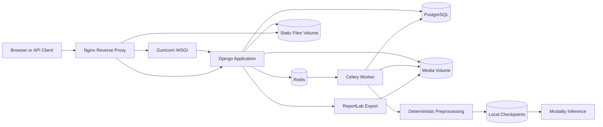
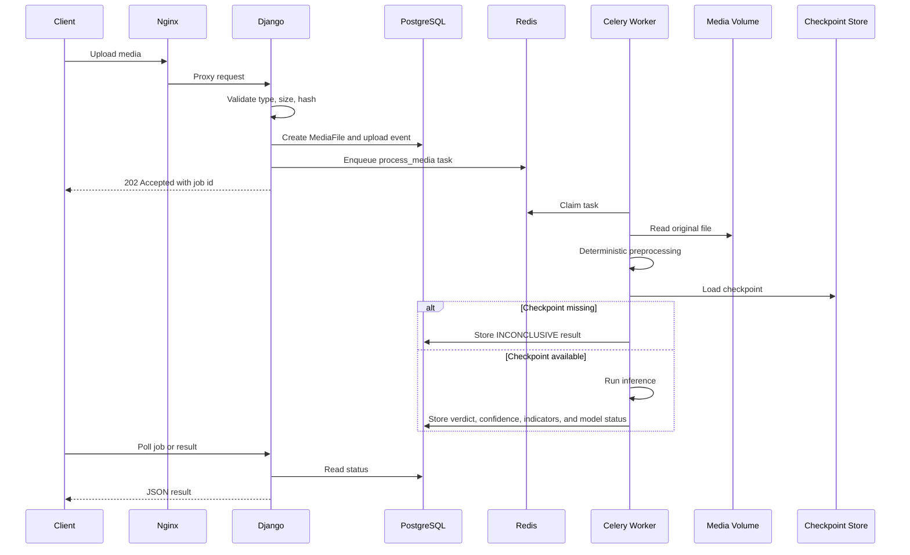
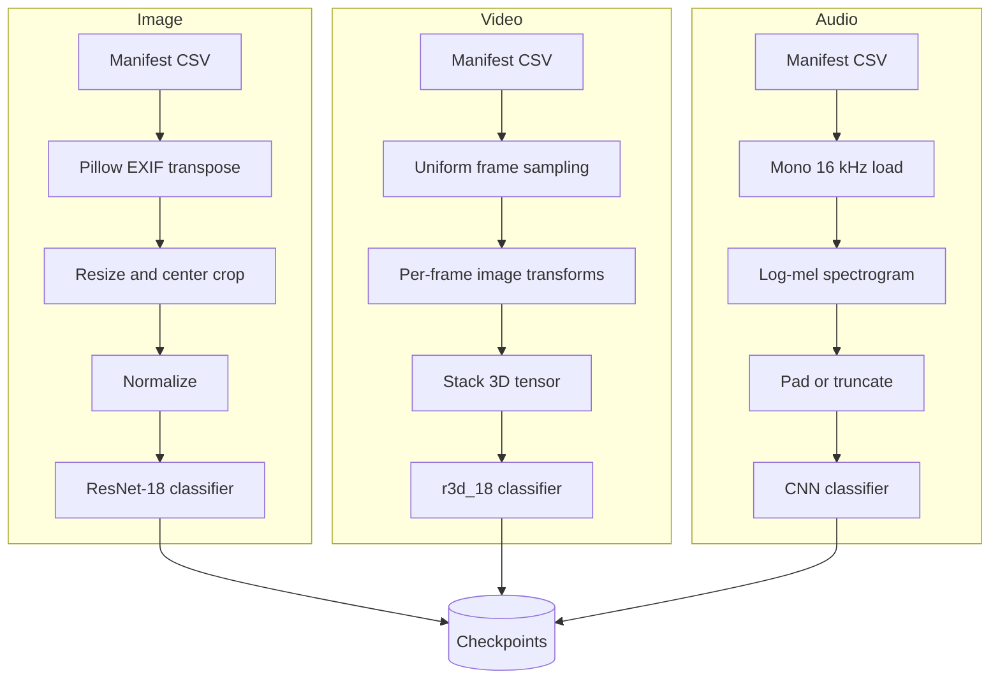

# DEEPFAKE SENTINEL Architecture

## Status of this document

This document describes the **implemented architecture** for DEEPFAKE SENTINEL. The Django project exposes server-rendered workspace pages, a REST API under `/api/`, modality analysis services, Celery-backed media processing, on-demand PDF report generation, and Docker Compose deployment. No trained model weights are bundled; analysis falls back to `INCONCLUSIVE` until checkpoints are produced locally.

## System overview

DEEPFAKE SENTINEL is a layered, container-friendly system. The web tier serves the workspace dashboard and handles authentication, validation, REST API requests, and case workflow. Long-running media analysis is pushed to Celery workers, while PDF reports are generated synchronously from stored evidence. PostgreSQL stores durable records, Redis coordinates work, and media/checkpoint files live on mounted volumes.

Nginx proxies authenticated API download requests, including report detail and PDF downloads, to Django. The HTML workspace exposes only `/reports/`; report detail and PDF download are API-only.

## Request and task flow

## Component responsibilities

| Component | Implemented in | Responsibility |
| --- | --- | --- |
| Nginx | `docker/nginx/nginx.conf` | Serves static assets, proxies dynamic requests, and enforces upload size. Media files are private and are not served directly; access is only through authenticated, object-scoped API download endpoints such as `GET /api/media/{id}/download/`. |
| Gunicorn | `docker/Dockerfile`, `docker/docker-compose.yml` | Runs the Django WSGI application in production processes. |
| Django project | `config/` | Settings, `/api/` router, URL routing, middleware, Celery wiring. |
| Django apps | App folders at repository root | Models, serializers, REST views, analysis services, and permissions. |
| Workspace UI | `templates/`, `static/css`, `static/js` | Dashboard, media library, investigations, reports, and API-driven interactions. |
| PostgreSQL | Docker service `db` | Durable store for users, media, analysis events, findings, cases, and reports. |
| Redis | Docker service `redis` | Celery broker and result backend when configured. |
| Celery worker | Docker service `celery` | Runs `process_media`, which executes metadata, integrity, forensic, modality, and explanation stages. |
| Reports | `reports/services.py` | Generates PDFs on demand from stored records; report generation is not a Celery job. |
| Media volume | `media/` and Docker volume | Stores original uploads, derived artifacts, and generated reports. |
| Static volume | `staticfiles/` and Docker volume | Stores collected static assets served by Nginx. |
| Manifest builders | `ml_training/datasets/` | Build local CSV manifests without downloading data. |
| Preprocessing | `ml_training/preprocessing/` | Deterministic transformations shared across training and inference. |
| Training | `ml_training/training/` | Train modality checkpoints and write real metrics. |
| Evaluation | `ml_training/evaluation/` | Compute held-out metrics from saved checkpoints. |
| Inference | `ml_training/inference/` | Standalone inference that refuses to guess without weights. |
| Checkpoint store | `ml_models/<modality>/weights/` | Local, versioned model artifacts. No weights are bundled. |
| Documentation | `docs/`, `README.md` | API, data, deployment, evaluation, and screenshot guidance. |

## Modality pipeline architecture

## Consistency rules

1. Training, evaluation, and inference must call the same preprocessing helpers.
2. Manifest paths are relative to `--data-root`; scripts must not rewrite them silently.
3. Every training-produced checkpoint records label mapping and preprocessing configuration.
4. Every analysis result records `model_version`, `model_status`, verdict, confidence, and heuristic indicators.
5. Missing or unreadable checkpoints force an `INCONCLUSIVE` result with no confidence value.
6. Metrics must come from generated JSON files or stored `ModelMetric` records only.
7. No script downloads datasets or weights automatically.

## Deployment topology

| Environment | Recommended settings |
| --- | --- |
| Local development | SQLite allowed only when `DJANGO_TEST_DB=True`; `DEBUG=True`; eager Celery optional. |
| Staging | PostgreSQL, Redis, Celery, `DEBUG=False`, real `SECRET_KEY`. |
| Production | Containers, Nginx TLS, restricted media access, backups, monitoring, `DEBUG=False`. |

## Failure modes

| Failure | Expected behavior |
| --- | --- |
| Checkpoint missing | Inference returns `INCONCLUSIVE` and explains the reason. |
| Redis unavailable | The broker is unreachable and new analysis tasks cannot be queued until it recovers. |
| PostgreSQL unavailable | Container or external monitoring reports the web service as unhealthy; analysis records cannot be read or written. |
| Invalid upload | API returns validation error without creating a media record. |
| Corrupt media file | Worker records an analysis error and preserves the original hash. |
| Evaluation manifest has no test split | Evaluation exits with a clear error; no metrics are invented. |
| Dataset license unknown | Dataset is not used for training until the owner records permission. |

## Related documents

- [ER diagram](er-diagram.md)
- [REST API](api.md)
- [Dataset guidance](datasets.md)
- [Model evaluation](model-evaluation.md)
- [Deployment](deployment.md)
