# DEEPFAKE SENTINEL Entity-Relationship Diagram

## Status of this document

The diagram below reflects the models and migrations in the implemented Django apps. Django's built-in auth models are included because they are part of the effective data model. No trained model weights are bundled; analysis verdicts remain `INCONCLUSIVE` until locally produced checkpoints are used.

```mermaid
erDiagram
    AUTH_USER ||--o| USER_PROFILE : "has"
    AUTH_USER ||--o{ ACTIVITY_LOG : "performs"
    AUTH_USER ||--o{ MEDIA_FILE : "owns"
    AUTH_USER ||--o{ INVESTIGATION : "creates"
    AUTH_USER |o--o{ INVESTIGATION : "assigned to"
    AUTH_USER ||--o{ OBSERVATION : "authors"
    AUTH_USER |o--o{ TIMELINE_EVENT : "acts in"
    AUTH_USER |o--o{ FORENSIC_REPORT : "generates"
    AUTH_USER |o--o{ EVIDENCE_ACCESS_LOG : "views"

    INVESTIGATION }o--o{ MEDIA_FILE : "links"
    INVESTIGATION ||--o{ OBSERVATION : "records"
    INVESTIGATION ||--o{ TIMELINE_EVENT : "records"
    INVESTIGATION |o--o{ FORENSIC_REPORT : "context for"

    MEDIA_FILE ||--o{ ANALYSIS_EVENT : "logs"
    MEDIA_FILE ||--o{ EVIDENCE_ACCESS_LOG : "logs"
    MEDIA_FILE ||--o| IMAGE_ANALYSIS : "has"
    MEDIA_FILE ||--o| VIDEO_ANALYSIS : "has"
    MEDIA_FILE ||--o| AUDIO_ANALYSIS : "has"
    MEDIA_FILE ||--o| METADATA_RECORD : "has"
    MEDIA_FILE ||--o| INTEGRITY_RECORD : "has"
    MEDIA_FILE ||--o| FORENSIC_RECORD : "has"
    MEDIA_FILE ||--o| EXPLANATION : "has"
    MEDIA_FILE ||--o{ FORENSIC_REPORT : "produces"

    AUTH_USER {
        bigint id PK
        string username
        string email
        boolean is_staff
        boolean is_active
        datetime date_joined
    }

    USER_PROFILE {
        bigint id PK
        bigint user_id FK
        string role
        string department
        string phone
        boolean is_active_account
        datetime created_at
    }

    ACTIVITY_LOG {
        bigint id PK
        bigint user_id FK "nullable"
        string action
        string model
        string object_id
        json metadata
        datetime created_at
    }

    MEDIA_FILE {
        uuid id PK
        bigint owner_id FK
        bigint investigation_id FK "nullable"
        string file
        string original_name
        string media_type
        string mime_type
        bigint size_bytes
        string sha256
        string status
        text error_message
        datetime uploaded_at
        datetime updated_at
    }

    ANALYSIS_EVENT {
        bigint id PK
        uuid media_id FK
        string stage
        string status
        text message
        datetime created_at
    }

    INVESTIGATION {
        uuid id PK
        string case_id UK
        string title
        text description
        string status
        string priority
        bigint created_by_id FK
        bigint assigned_to_id FK "nullable"
        datetime created_at
        datetime updated_at
    }

    OBSERVATION {
        bigint id PK
        uuid investigation_id FK
        bigint author_id FK
        text note
        datetime created_at
    }

    TIMELINE_EVENT {
        bigint id PK
        uuid investigation_id FK
        text event
        bigint actor_id FK "nullable"
        datetime created_at
    }

    EVIDENCE_ACCESS_LOG {
        bigint id PK
        uuid media_id FK
        bigint user_id FK "nullable"
        string action
        string ip_address "nullable"
        text user_agent
        datetime created_at
    }

    IMAGE_ANALYSIS {
        bigint id PK
        uuid media_id FK
        string model_version
        string model_status
        string verdict
        float confidence "nullable"
        json indicators
        int face_count
        float artifact_score
        datetime created_at
        datetime updated_at
    }

    VIDEO_ANALYSIS {
        bigint id PK
        uuid media_id FK
        string model_version
        string model_status
        string verdict
        float confidence "nullable"
        int frame_count
        int sampled_frames
        json suspicious_frames
        float temporal_consistency "nullable"
        json indicators
        datetime created_at
        datetime updated_at
    }

    AUDIO_ANALYSIS {
        bigint id PK
        uuid media_id FK
        string model_version
        string model_status
        string verdict
        float confidence "nullable"
        float duration_seconds
        int sample_rate
        string waveform_path
        string spectrogram_path
        json features
        json suspicious_segments
        json indicators
        datetime created_at
        datetime updated_at
    }

    METADATA_RECORD {
        bigint id PK
        uuid media_id FK
        json raw
        json exif
        json technical
        json anomalies
        datetime created_at
    }

    INTEGRITY_RECORD {
        bigint id PK
        uuid media_id FK
        string original_hash
        string current_hash
        string status
        datetime verified_at
    }

    FORENSIC_RECORD {
        bigint id PK
        uuid media_id FK
        text summary
        json anomalies
        json evidence
        string risk_level
        datetime created_at
    }

    EXPLANATION {
        bigint id PK
        uuid media_id FK
        text summary
        json indicators
        json recommendations
        json limitations
        string evidence_source
        datetime created_at
    }

    FORENSIC_REPORT {
        uuid id PK
        string report_id UK
        uuid media_id FK
        uuid investigation_id FK "nullable"
        bigint generated_by_id FK "nullable"
        string pdf
        string version
        string sha256
        string hash_chain
        datetime created_at
    }

    MODEL_METRIC {
        bigint id PK
        string model_name
        string version
        float accuracy "nullable"
        float precision "nullable"
        float recall "nullable"
        float f1 "nullable"
        int sample_count
        datetime trained_at "nullable"
        string source
        boolean is_trained
        datetime created_at
    }
```

## Entity responsibilities

| Entity | Purpose |
| --- | --- |
| `AUTH_USER`, `USER_PROFILE` | Django authentication plus role and department metadata. |
| `ACTIVITY_LOG` | Audit trail for user actions such as login, upload, and case updates. |
| `INVESTIGATION` | Case container with generated `case_id`, status, priority, creator, assignee, and linked media. |
| `OBSERVATION`, `TIMELINE_EVENT` | Human notes and case activity history. |
| `MEDIA_FILE` | Uploaded artifact with type, size, SHA-256, status, and optional investigation link. |
| `ANALYSIS_EVENT` | Stage-by-stage Celery processing events for one media artifact. |
| `EVIDENCE_ACCESS_LOG` | Record of media views and reprocessing actions. |
| `IMAGE_ANALYSIS`, `VIDEO_ANALYSIS`, `AUDIO_ANALYSIS` | Modality records with model status, verdict, confidence, and deterministic indicators. |
| `METADATA_RECORD` | EXIF, container, filesystem, and technical facts plus labelled anomalies. |
| `INTEGRITY_RECORD` | Recorded and recomputed SHA-256 hashes with `VERIFIED`, `TAMPERED`, or `UNAVAILABLE` status. |
| `FORENSIC_RECORD` | Aggregated anomalies, evidence rows, and an informational risk level. |
| `EXPLANATION` | Deterministic summary, indicators, recommendations, and limitations built from stored analysis fields. |
| `FORENSIC_REPORT` | Generated PDF file, version, report hash, and prior-record hash chain for one media artifact; it has no status field. |
| `MODEL_METRIC` | Metrics imported from your own training/evaluation runs; no metrics are fabricated by the application. |

## Modeling rules

- `MEDIA_FILE.status` values are `PENDING`, `PROCESSING`, `COMPLETED`, and `FAILED`.
- `INVESTIGATION.status` values are `OPEN`, `IN_PROGRESS`, `CLOSED`, and `ARCHIVED`.
- Analysis verdicts are `INCONCLUSIVE`, `LIKELY_MANIPULATED`, or `LIKELY_AUTHENTIC`; `model_status` records whether a trained checkpoint was applied.
- Without a trained checkpoint, verdict is `INCONCLUSIVE` and confidence is `null`.
- `MEDIA_FILE.sha256` is the chain-of-custody anchor recorded at upload and rechecked by `INTEGRITY_RECORD`.
- Heuristic indicators are observations, not proof of manipulation or authenticity.
- `FORENSIC_REPORT` stores a PDF only; there is no CSV or JSON report entity and no report status field.
- Dashboard analytics are computed from stored records and must not be presented as model accuracy or validation results.

## Implementation note

These tables are created by the migrations under each app directory. Update this diagram when models or migrations change.
