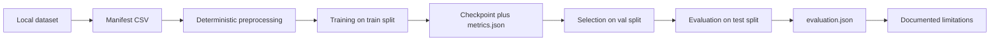

# Model Evaluation in DEEPFAKE SENTINEL

## Availability of metrics

**No evaluation metrics are available in this repository until you generate them.** No trained weights are bundled. Training writes `metrics.json` only from data it actually processed, and evaluation writes `evaluation.json` only after loading a checkpoint and a manifest. If validation or test data is absent, the generated JSON records `null` values and a clear status; it never invents numbers.

Do not copy benchmark results from papers into project documentation as DEEPFAKE SENTINEL results.

## Evaluation lifecycle



## Step 1: Freeze the manifest

A manifest must be immutable for a reported result. Record:

- Manifest file path and SHA-256.
- `--data-root` used.
- Split counts.
- Dataset source and license record.
- Any subject-level or source-level separation rules.

## Step 2: Train with a validation split

```bash
python -m ml_training.training.train_image --manifest D:/manifests/images.csv --data-root D:/datasets/images --epochs 10 --split val
```

Outputs:

```text
ml_models/image/weights/image_detector.pt
ml_models/image/weights/labels.json
ml_models/image/weights/metrics.json
```

If the manifest has no `val` rows, `metrics.json` contains `status: "no_validation_data"` with null metrics. The checkpoint may still be produced, but it must not be described as selected on validation data.

## Step 3: Evaluate once on the test split

```bash
python -m ml_training.evaluation.evaluate_image --manifest D:/manifests/images.csv --data-root D:/datasets/images --split test
```

Outputs:

```text
ml_models/image/weights/evaluation.json
```

Repeat with `train_video`/`evaluate_video` and `train_audio`/`evaluate_audio` for other modalities.

## Generated JSON schema

Training `metrics.json` and evaluation `evaluation.json` include:

| Field | Meaning |
| --- | --- |
| `status` | `ok`, `no_validation_data`, or another explicit state. |
| `manifest` | Path to the manifest used. |
| `data_root` | Root used to resolve relative paths. |
| `split` | Split evaluated. |
| `checkpoint` | Checkpoint path when applicable. |
| `labels` | Ordered label list used by the model. |
| `num_samples` | Number of evaluated samples. |
| `accuracy` | Correct predictions divided by total predictions. |
| `precision` | True positives divided by true plus false positives, per class and weighted. |
| `recall` | True positives divided by true positives plus false negatives, per class and weighted. |
| `f1` | Harmonic mean of precision and recall, per class and weighted. |
| `confusion_matrix` | Rows are true labels, columns are predicted labels. |
| `generated_at` | UTC timestamp. |

Example shape with null values when no data is available:

```json
{
  "status": "no_validation_data",
  "split": "val",
  "num_samples": 0,
  "accuracy": null,
  "precision": null,
  "recall": null,
  "f1": null,
  "confusion_matrix": null
}
```

This is an illustration of the schema, not a reported result.

## Metric definitions

Given a binary confusion matrix:

|  | Predicted fake | Predicted real |
| --- | --- | --- |
| **Actual fake** | True Positive (TP) | False Negative (FN) |
| **Actual real** | False Positive (FP) | True Negative (TN) |

- **Accuracy** = `(TP + TN) / (TP + TN + FP + FN)`
- **Precision** = `TP / (TP + FP)`
- **Recall** = `TP / (TP + FN)`
- **F1** = `2 * precision * recall / (precision + recall)`

The scripts use scikit-learn with `zero_division=0`, so undefined precision or recall is reported as `0.0` for that class rather than crashing. Weighted and macro aggregates are also stored.

## Interpreting results responsibly

- Accuracy can be misleading on imbalanced datasets. Always inspect precision, recall, and the confusion matrix.
- Choose the operating threshold on `val`, then report once on `test`.
- Report the domain: generator family, compression, codec, resolution, language, and device.
- A result on one dataset does not transfer to another domain.
- Confidence scores are not calibrated probabilities unless a calibration step is explicitly documented.
- Keep `INCONCLUSIVE` as the default when evidence is insufficient.

## Threshold policy

No default production threshold is asserted by this project. The evaluation owner should:

1. Define acceptable false-positive and false-negative costs for the use case.
2. Select a threshold on the validation split.
3. Record that threshold with the checkpoint configuration.
4. Apply the same threshold during inference.
5. State the threshold and its source in any report.

## Checkpoint provenance

Every checkpoint should be accompanied by:

- Checkpoint filename and SHA-256.
- Training manifest SHA-256.
- Preprocessing configuration.
- Label mapping.
- Training epochs and batch size.
- Library versions where available.
- Evaluation result file path.

Inference output must include `checkpoint_id` and `checkpoint_sha256` when a verdict is produced. If either is missing, the result is `INCONCLUSIVE`.

## Failure handling

| Condition | Expected behavior |
| --- | --- |
| Checkpoint missing | Evaluation and inference exit with an explicit error or `INCONCLUSIVE` result. |
| Manifest missing split | Evaluation exits without writing fabricated metrics. |
| File path missing | Sample is reported as an error; do not silently skip and inflate metrics. |
| Label mapping mismatch | Evaluation fails loudly rather than remapping unknown labels. |
| Corrupt media | Sample is counted as an error in the evaluation output. |

## Reporting guidance

A report generated from DEEPFAKE SENTINEL should include:

- The exact checkpoint identifier.
- The manifest and split used for evaluation.
- The generated metrics file, not hand-typed numbers.
- A limitations section stating domain shift and inconclusive defaults.
- Clear separation of automated output from human conclusion.

## Related documents

- [Dataset guidance](datasets.md)
- [Architecture](architecture.md)
- [Model folders](../README.md#12-ml-model-details)
